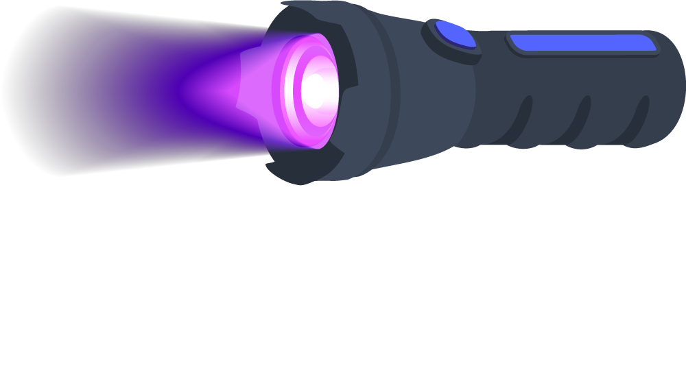

<p align="center">
  
</p>

# Blacklight

Blacklight has two separate phases:

**Scout** performs endpoint triage for Codex, Claude Code, Cursor, Antigravity CLI, Grok, Devin CLI, Strands Agents, Kiro CLI, OpenCode, and Muse Code. Scout does not read session bodies or Grok auth, memory, logs, or terminal logs.

**Session Analysis** parses selected Codex, Claude Code, Cursor, Antigravity CLI, Grok, OpenCode, and Muse Code chat artifacts.

See the [agent and CLI collection matrix](docs/matrix.md) for artifact coverage by tool and platform.

## Workflow

1. **Scout the endpoint.** Find candidate session artifacts without reading their bodies.
2. **Choose and download files.** Transfer only the artifacts you want to review.
3. **Analyze downloads.** Create ranked, redacted local reports.

> [!IMPORTANT]
> Blog detailing the project: https://specterops.io/blog/2026/08/12/blacklight-ai-agent-endpoint-artifacts/

## What is in this repository

| Directory | Purpose |
| --- | --- |
| `blacklight-scout/` | Endpoint-native Scout artifacts for bounded metadata triage and session-candidate discovery. |
| `blacklight/` | Python CLI that discovers, parses, prioritizes, and reports on downloaded sessions. |
| `blacklight-rules/` | Defender inventory, exposure review, and detection guidance for these artifacts. |

## Phase 1: Scout the endpoint

Scout performs bounded metadata and filesystem triage. It identifies configuration, rules, authentication metadata, and candidate session paths, but does not read session bodies or print credential/configuration values. Grok reconnaissance covers actionable paths under `.grok`, including auth, config, session state, memory, plugins, skills, logs, and worktree state. Devin CLI, Strands Agents, Kiro CLI, OpenCode, and Muse Code coverage is existence and path enumeration only for known install, config, auth, cache, log, and session-root locations. See the [agent and CLI collection matrix](docs/matrix.md) for full catalog coverage.

### Build Scout

Build the Windows and Linux matrix with Docker:

```powershell
.\blacklight-scout\build.ps1
```

```bash
./blacklight-scout/build.sh
```

Build the macOS library on macOS:

```bash
make -C blacklight-scout release-macos
```

Build products are written to `out/build/scout/`.

| Artifact | Platform | Use |
| --- | --- | --- |
| `ai_path_scout.x64.o` | Windows x64 | No-argument BOF filesystem-triage snapshot. |
| `ai_path_scout-windows-x64.exe` | Windows x64 | Native endpoint assessment executable. |
| `ai_path_scout-managed.exe` | Windows .NET Framework 4.7.2 | Managed endpoint assessment for Apollo. |
| `libai_path_scout.so` | Linux x64 | No-argument filesystem-triage library. |
| `libai_path_scout.dylib` | macOS | No-argument filesystem-triage library. |

### Use Scout

The BOF and POSIX libraries take no filters. Windows executables support tool filtering:

```bash
ai_path_scout-windows-x64.exe --include-tool codex
ai_path_scout-managed.exe --include-tool cursor
```

For artifact interfaces and runner-specific behavior, see the [Scout guide](blacklight-scout/README.md).

## Phase 2: Analyze selected downloads

Install [uv](https://docs.astral.sh/uv/getting-started/installation/), then run these commands from the repository root. uv selects Python 3.11 and installs locked dependencies in `.venv`; no environment activation is needed.

```bash
uv sync --locked
uv run --locked blacklight sessions ~/Downloads/HOST-001 \
  --run-id HOST-001 \
  --output-directory out/results/HOST-001/reports
```

Analyze the current user's known session roots, or select one tool:

```bash
uv run --locked blacklight sessions local
uv run --locked blacklight sessions local --tool codex
```

Inputs can be directories or individual JSONL, compressed Codex `.jsonl.zst`, and supported SQLite files. Each run writes matching JSON and text reports; `--output-directory` sets their location. Use `--include`, `--exclude`, `--max-files`, and `--max-file-size` to limit scope.

```bash
uv run --locked blacklight sessions --help
```

See the [session analysis guide](docs/session-analysis.md) for input coverage, report contents, progress, and developer commands.

## Documentation

| Guide | When to use it |
| --- | --- |
| [Architecture](docs/architecture.md) | Boundaries, data flow, and parsing limits. |
| [Agent and CLI collection matrix](docs/matrix.md) | Catalog-generated agent, platform, artifact-family, and collection coverage. |
| [Defender Rules](blacklight-rules/README.md) | Inventory, exposure review, and detections. |

OpenCode V1/V2 SQLite support and Muse durable-event coverage are described in [OpenCode sessions](docs/opencode-sessions.md) and [Muse sessions](docs/muse-sessions.md). Unknown Muse record types are skipped; retention can remove previously stored sessions.

## Research and contributions

Blacklight pulled some artifact paths from the [Endpoint AI Agent Abuse
(EAA) technique catalog](https://github.com/0x4D31/endpoint-ai-agent-abuse/blob/main/techniques/index.md).
Contributions that improve endpoint visibility, evidence handling, or defensive
guidance are welcome through issues and pull requests.
